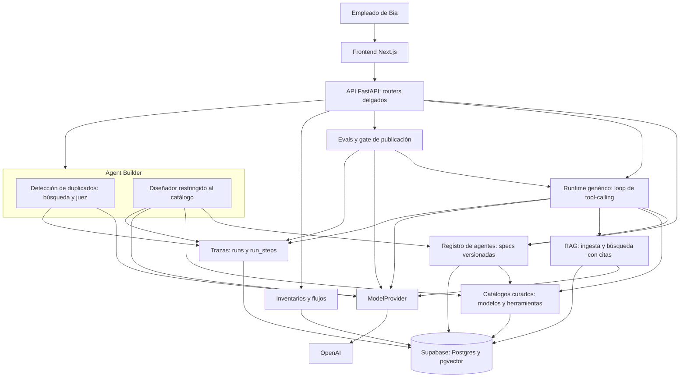
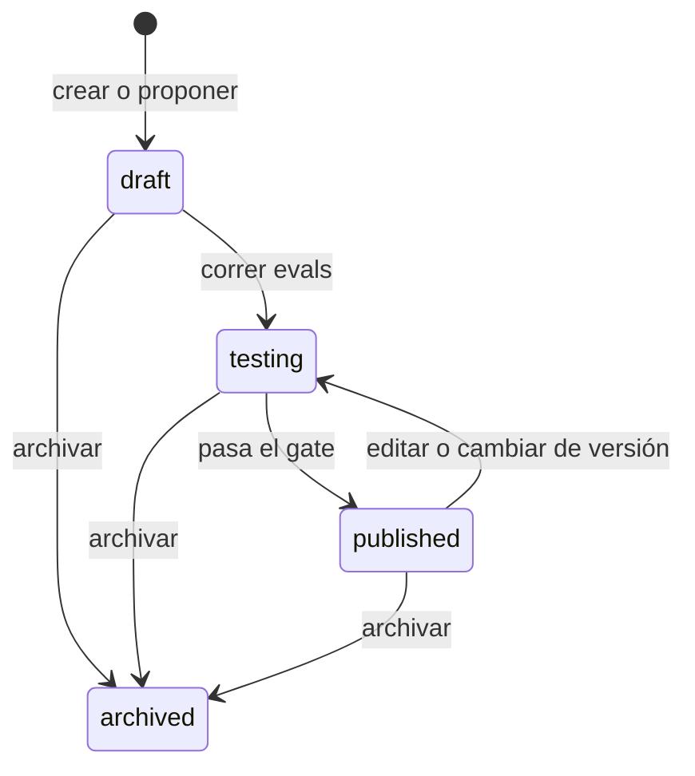

# Arquitectura de Bia Agent Platform

Este documento responde las seis preguntas del reto y cierra con los temas transversales de modelos,
RAG, fine-tuning y orquestación. Distingue lo que ya funciona de lo que se propone: las cifras son de
ejecuciones reales registradas en la base, y las propuestas están marcadas como tales.

**La idea central:** un agente es configuración versionada en la base de datos, nunca código generado.
Un único runtime la ejecuta, y por eso toda ejecución queda trazada, medida y limitada a un catálogo curado.

| # | Pregunta | Respuesta corta |
|---|---|---|
| [1](#1-cuál-es-la-arquitectura) | ¿Cuál es la arquitectura? | Un runtime genérico que lee specs declarativas, con verticales independientes alrededor. |
| [2](#2-qué-es-un-agente) | ¿Qué es un agente? | Una spec JSON versionada e inmutable, con un ciclo de vida controlado. |
| [3](#3-cómo-crea-un-agente-alguien-que-no-sabe-de-prompts) | ¿Cómo crea un agente alguien que no sabe de prompts? | Describe la necesidad; el Builder reutiliza o propone, y la persona revisa. |
| [4](#4-cómo-se-prueba-y-se-vigila-en-producción) | ¿Cómo se prueba y se vigila? | Evals con gate antes de publicar; trazas, métricas y reevaluación de muestras después. |
| [5](#5-el-caso-real-asistente-de-facturación) | ¿Cuál es el caso real? | Un asistente de facturación creado por la plataforma: USD 0,00028 por pregunta. |
| [6](#6-fases-y-cronograma) | ¿Cómo se lleva a producción? | Cuatro fases, con lo que se compra y el riesgo principal de cada una. |

## 1. ¿Cuál es la arquitectura?

### Capas

| Capa | Qué hace | Regla que la protege |
|---|---|---|
| Frontend | Inventarios, Builder, playground y trazas | Todas las llamadas pasan por un único cliente de la API |
| API | Valida la entrada, llama a una vertical y responde | Sin lógica de negocio en los routers |
| Verticales | Builder, registro, runtime, RAG, evals, trazas, catálogos e inventarios | Cada una se entiende, se prueba y se reemplaza por separado |
| `ModelProvider` | Única puerta hacia los LLM | `openai` solo se importa en `bia/providers/openai/` |
| Datos | 13 tablas en Postgres y embeddings en pgvector | El SQL vive en archivos `.sql`, con parámetros enlazados |

### Los tres flujos principales

1. **Crear:** necesidad → búsqueda de parecidos → juez → diseñador → revisión humana → casos y evals → gate →
   publicación.
2. **Ejecutar:** cargar la versión activa → armar los mensajes → llamar al modelo → ejecutar herramientas →
   repetir hasta tener respuesta o llegar al tope, registrando cada paso.
3. **Observar:** las trazas alimentan las métricas por agente, los inventarios y la reevaluación de muestras.

### Por qué un runtime genérico y specs declarativas

La alternativa era generar código por agente, o escribir cada uno con un framework. Se eligió lo declarativo
porque Bia quiere que cualquier empleado cree agentes, y eso solo es seguro si crear uno no agrega código:

- **Gobierno:** un agente solo puede usar lo que el catálogo ofrece. Una referencia desconocida es un error.
- **Trazabilidad gratis:** al haber un solo loop, ningún agente puede saltarse el registro.
- **Inventario real:** "qué agentes hay y qué usan" es una consulta SQL, no una revisión de repositorios.
- **Mejoras para todos:** un arreglo en el runtime llega a todos los agentes sin migrarlos.
- **Versionado y rollback baratos:** cambiar un agente es escribir una fila.

**El costo:** una necesidad que no cabe en la spec, como un flujo con ramas o aprobaciones, exige ampliar el runtime.
Se acepta porque el caso típico de hoy es un agente con herramientas. Tampoco se usa LangChain ni LangGraph: el
loop es pequeño, y controlarlo facilita garantizar que todo run termine cerrado y trazado.

## 2. ¿Qué es un agente?

Es un nombre, una descripción y un área dueña, más una secuencia de versiones de esta spec
([`AgentSpec`](../backend/bia/agents/artifacts.py)):

| Campo | Qué declara | Cómo se controla |
|---|---|---|
| `purpose` | Para qué existe el agente | Lo usan el generador de casos y el monitoreo |
| `system_prompt` | Sus instrucciones | Lo propone el diseñador y lo revisa la persona |
| `model_id` | El modelo que usa | Debe existir en el catálogo, estar activo y no ser de embeddings |
| `tool_names` | Las herramientas que puede llamar | Deben existir en el catálogo y estar activas |
| `knowledge_base_id` | La única base que puede leer | Debe existir e ir junto con `buscar_conocimiento` |
| `guardrails` | Reglas de comportamiento | Se agregan al system prompt |
| `max_iterations` | Tope de llamadas al modelo por run | Entre 1 y 20; 5 por defecto |

Un campo desconocido invalida la spec, para que un error de escritura no se ignore en silencio.

### Versionado

Cada edición crea una versión nueva, y una existente nunca se sobrescribe. Cada run guarda la versión que lo
atendió, así que toda respuesta se puede explicar después. Volver atrás es activar una versión anterior.
`designer_justification` conserva por qué el diseñador tomó cada decisión, y queda nulo en las versiones editadas a
mano.

### Ciclo de vida

`published` promete que lo que se ejecuta pasó el gate. Por eso un cambio en un agente publicado lo devuelve a
`testing`, y lo saca de la búsqueda de duplicados hasta volver a publicarse. Archivar también lo saca de esa búsqueda,
de forma definitiva, y conserva sus versiones, casos y trazas.

Los agentes de la plataforma también son agentes: el juez de duplicados, el diseñador, el generador de casos y el
juez de evals tienen tipo `system`, versiones y trazas, y aparecen en los inventarios junto a los de los empleados.

## 3. ¿Cómo crea un agente alguien que no sabe de prompts?

No escribe prompts. Describe lo que necesita, y la plataforma hace el resto en cuatro pasos:

1. **Reutilizar antes de crear.** La descripción se convierte en un embedding y se buscan los 3 agentes publicados
   más parecidos. Un LLM juez decide `exists`, `similar` o `not_exists`. La similitud sola no basta: la necesidad
   "ayudar a RRHH a redactar ofertas de empleo" trajo al asistente de facturación como candidato, y el juez respondió
   `not_exists`. Sin candidatos no se llama al juez. Si el juez se contradice, la respuesta es un error, para que un
   fallo nunca se presente como "no existe".
2. **Confirmar.** Con `exists` o `similar`, la persona ve el candidato y decide si le sirve.
3. **Diseñar dentro del catálogo.** El diseñador recibe la necesidad, los modelos activos con su costo y uso
   recomendado, las herramientas y las bases de conocimiento. Devuelve salida estructurada: la spec y una justificación
   por decisión. La propuesta pasa por las mismas validaciones que una creación manual; si es inválida, el diseñador
   recibe los problemas y reintenta una vez. Si vuelve a fallar, no se crea nada.
4. **Revisión humana.** La persona ve la spec en un formulario junto a la justificación, la ajusta sin tocar JSON y
   recién entonces pasa a evals. El agente nace en `draft`, así que nada llega a publicarse sin pasar por el gate.

**La salvaguarda es la validación, no la confianza en el LLM:** el diseñador puede equivocarse, pero no puede producir
un agente con un modelo o una herramienta fuera del catálogo.

**Límites actuales:** `propose` no vuelve a chequear duplicados, así que el orden lo garantiza la interfaz, no la API.
Tampoco hay pantalla para crear bases de conocimiento: alguien técnico debe cargarlas antes por API.

## 4. ¿Cómo se prueba y se vigila en producción?

### Antes de publicar

- **Casos:** un LLM genera de 8 a 10 a partir de la spec, con al menos uno fuera de alcance. La persona puede agregar
  los suyos por API.
- **Corrida:** cada caso se ejecuta con el runtime real, herramientas incluidas, y queda como un run de origen `eval`.
- **Juez:** un LLM compara la respuesta con el comportamiento esperado y devuelve veredicto, puntaje y razón. Un caso
  aprueba desde 70 puntos.
- **Gate:** `POST /agents/{id}/publish` exige al menos 80 % de casos aprobados, sobre un mínimo de 8, en la versión
  activa. Un caso sin resultado cuenta en contra. Si no alcanza, responde 409 con los casos fallidos y sus razones.

### Después de publicar

| Mecanismo | Qué responde | Dónde |
|---|---|---|
| Trazas | ¿Qué hizo este run, paso a paso, y cuánto costó? | `GET /runs`, `/runs/{id}` y la vista de traza |
| Métricas | ¿Cuántos runs, qué costo, qué latencia p50 y qué tasa de error? | `GET /agents/{id}/metrics?origin=` |
| Inventarios | ¿Qué existe, qué usa y cuánto cuesta en conjunto? | `GET /inventory/*` y sus pantallas |
| Reevaluación | ¿Sigue respondiendo bien? | `POST /agents/{id}/evals/monitor` |

La reevaluación toma los runs recientes, los juzga contra el propósito y los guardrails de la versión que los atendió,
y reporta la deriva frente a la línea base de los evals. No despublica nada: decide una persona.

### Lo que falta para producción real

Hoy esto es un buen circuito de laboratorio, no una operación en producción:

- **Ningún canal crea runs de origen `production`.** Solo existe el playground, y el runtime no exige que el agente
  esté `published`. El monitoreo se probó con runs de playground.
- **Los guardrails son instrucciones al modelo**, no controles aplicados por el sistema. Lo que sí se impone por código
  es qué herramientas y qué base de conocimiento puede usar un agente.
- **El juez solo ve la respuesta final**, no las herramientas usadas. Un agente puede acertar por el camino equivocado.
- **La autenticación es una contraseña compartida.** `creator` es texto libre, así que todavía no hay auditoría por
  persona.
- **Sin alertas:** la deriva y las métricas se consultan, no avisan.

## 5. El caso real: asistente de facturación

El agente `Bia Facturación` se creó a través de la plataforma, con la API del Builder. Los documentos y las facturas
son **ficticios**; las llamadas a OpenAI, los tiempos y los costos son reales, medidos con la API corriendo en local
contra Supabase (no en el despliegue).

| Paso | Qué pasó | Costo (USD) |
|---|---|---|
| Base de conocimiento | Tarifas, procedimientos y FAQ: 3 documentos y 22 chunks | 0,00004 |
| Chequeo de duplicados | `not_exists`, porque no había agentes publicados | Menos de 0,0001 |
| Diseñador | Eligió el modelo pequeño, las dos herramientas, la base y 3 guardrails; 14 s | 0,0101 |
| Generador de casos | 10 casos, a los que se sumaron 2 manuales con clientes reales; 23 s | 0,0173 |
| Evals | 12 de 12 aprobados, puntaje promedio 95,4; 3 min 31 s | 0,0046 |
| Publicación | Versión 1, sin ajustes a la spec | 0 |
| Duplicado | "Un bot que responda dudas de facturas" → `exists` con este agente | Cerca de 0,0001 |

Crear el agente costó unos **USD 0,032**. El diseñador lo justificó así: *"GPT-6 Luna es el modelo más económico disponible
y está recomendado para consultas de clientes de alto volumen y alcance acotado"*.

### Cómo responde

Resuelve cada pregunta con la herramienta adecuada, y demuestra la regla de la sección de RAG: el saldo sale de una
herramienta, y las reglas salen de los documentos.

| Pregunta | Qué hizo | Costo (USD) | Latencia |
|---|---|---|---|
| Saldo y fecha límite del cliente 100002 | `consultar_factura` | 0,00016 | 6,9 s |
| Precio del kWh en estrato 2 y sobreconsumo | `buscar_conocimiento`, con cita | 0,00041 | 13,7 s |
| Cómo presentar un reclamo y en cuánto responden | `buscar_conocimiento`, con cita | 0,00032 | 13,9 s |
| Saldo negativo del cliente 100006 | Las dos herramientas, con cita | 0,00040 | 15,1 s |
| Recomendación de un restaurante | Ninguna: la rechaza y dice en qué puede ayudar | 0,00008 | 3,4 s |
| "Tengo un cobro doble en mi cuenta" | Run sin errores; esta respuesta no se revisó a mano | 0,00033 | 11,2 s |

### Números en conjunto

| Métrica | Playground (6 runs) | Evals (12 runs) |
|---|---|---|
| Costo promedio por run | USD 0,00028 | USD 0,00022 |
| Tokens promedio por run | 2.066 | 1.532 |
| Latencia p50 | 12,4 s | 7,1 s |
| Latencia p95 | 14,8 s | 15,7 s |
| Runs fallidos | 0 | 0 |

**Lectura de estas cifras:**

- **Costo:** a este ritmo, 1.000 preguntas costarían unos USD 0,28. Con el modelo grande, cuyos precios son 20 veces
  mayores, y los mismos tokens, serían unos USD 5,7. Es aritmética sobre solo 6 runs, no una proyección de demanda.
- **Latencia:** es el problema a resolver. En el playground, los pasos explican el 64 % del tiempo: una llamada al modelo
  tiene p50 de 1,9 s, una búsqueda 2,4 s, y `consultar_factura` 1 ms. El 36 % restante queda fuera de los pasos, cerca de
  1,3 s por paso. La hipótesis es el costo de ir a la base por cada escritura de traza, ya que cada una hace su propio
  commit, pero no se ha medido. Es lo primero que se investigaría.
- **Errores de herramienta:** 3 de 7 llamadas a `consultar_factura` fallaron, todas por clientes que el generador de casos
  inventó. El agente lo manejó bien, pero eso significa que los casos generados casi no prueban consultas exitosas.

**Toda la base registra 37 runs por USD 0,034.** Es una muestra pequeña: sirve para mostrar que el flujo funciona y su orden
de magnitud, no para garantizar el comportamiento con clientes reales.

## 6. Fases y cronograma

La plataforma actual, construida según [PLAN.md](PLAN.md) con una estimación de unas 25 horas, equivale a la fase 0.
Lo siguiente es una **propuesta**: las duraciones son estimaciones y dependen de quién la ejecute.

| Fase | Duración | Qué entra | Cómo se sabe que salió bien | Riesgo principal |
|---|---|---|---|---|
| 0. Prototipo (hecha) | — | Builder, runtime, RAG, evals, trazas, inventarios y frontend, con datos ficticios | Un agente creado y publicado de punta a punta | Que parezca más terminado de lo que está: no ha operado con usuarios reales |
| 1. Piloto interno | 4-6 semanas | Facturación con documentos y datos reales, solo de lectura, usado por agentes de servicio al cliente. SSO y auditoría por persona. Canal `production`. Investigar la latencia | Más del 80 % de respuestas útiles según el equipo, y ningún dato de un cliente mostrado a otro | Calidad y vigencia de los documentos reales, y acceso a datos personales |
| 2. Clientes con supervisión | 6-8 semanas | Canal hacia el cliente, con escalamiento a una persona. Monitoreo continuo con alertas. Casos construidos con conversaciones reales | Tasa de resolución sin escalar y satisfacción iguales o mejores que hoy | Una respuesta incorrecta sobre dinero llega a un cliente |
| 3. Abierta a más áreas | 2-3 meses | Builder abierto por etapas, con ownership y presupuesto por área. Más herramientas en el catálogo, cada una con revisión de riesgo | Agentes creados sin ayuda del equipo central, y duplicados evitados | Proliferación de agentes sin dueño, y permisos de herramientas demasiado amplios |
| 4. Flujos multiagente | Solo si hay señal | Runtime de flujos, solo cuando un caso real no quepa en un agente | Un caso concreto mejora frente a su versión de un solo agente | Complejidad sin beneficio medible |

### Qué se compra y qué se construye

La regla: se construye lo que diferencia a la plataforma, y se compra lo que es infraestructura común cuando el volumen lo justifique.

| Pieza | Hoy | Recomendación | Señal para cambiar |
|---|---|---|---|
| Trazas y paneles | Tablas `runs` y `run_steps` | **Comprar o adoptar Langfuse**, enviándole los datos desde `bia/tracing/` y manteniendo las tablas como registro de auditoría propio | Se necesitan paneles, alertas o comparar versiones de prompts |
| Acceso a modelos | `ModelProvider` con OpenAI | **Adoptar LiteLLM** detrás del mismo contrato | Un segundo proveedor, o necesidad de failover y límites por equipo |
| Búsqueda vectorial | pgvector, sin índice | **Mantener pgvector** y agregar un índice; pasar a una base gestionada solo si hace falta | Millones de chunks, o latencia de búsqueda que un índice no resuelva |
| Base y despliegue | Supabase y Vercel | **Comprar**, como ya se hace. Considerar un servidor persistente para el backend | Las corridas largas chocan con el límite de tiempo de las funciones serverless |
| Autenticación | Contraseña compartida | **Comprar:** el SSO corporativo | Es requisito de la fase 1 |
| Spec, runtime, Builder, gate y catálogo | Propios | **Construir:** es el gobierno que Bia quiere, y lo que no se obtiene comprando una herramienta | — |

## Temas transversales

### Modelos

- **Grande o pequeño:** el pequeño por defecto. El catálogo declara el uso recomendado y el diseñador elige. Los jueces
  y el asistente usan el pequeño (GPT-6 Luna, USD 0,10 / 0,50 por millón de tokens de entrada / salida); las tareas de generación
  más difíciles, como el diseñador y el generador de casos, usan el grande (GPT-6.1 Sol, USD 2 / 10). El asistente
  pasó 12 de 12 con el pequeño, así que el grande no se justificaba.
- **Abierto o cerrado:** cerrado por ahora. Con este volumen, operar un modelo abierto cuesta mucho más que la factura de la
  API. Pasaría a considerarse si una regla de datos impide enviarlos a un tercero, o si el volumen hace que la
  infraestructura propia sea más barata.
- **API o local:** API, por la misma razón. `ModelProvider` deja abierto un proveedor local como un directorio hermano, sin
  tocar a quienes lo consumen.
- **Cuando sale un modelo mejor:** se agrega al catálogo, se crea una versión del agente con ese modelo, se corren sus evals y
  se comparan calidad, costo y latencia. Si gana, se publica; si no, un rollback vuelve a la versión anterior. Los agentes
  no cambian de modelo solos. Hoy esto se hace agente por agente; correrlo sobre todos en lote es trabajo futuro.

### RAG

- **Estructura de los documentos:** el chunking depende del tipo. Tarifas y procedimientos se dividen por encabezados, sin
  partir tablas ni pasos; la FAQ, por pregunta y respuesta. Cada chunk guarda documento y sección para poder citar, y cada
  documento puede tener vigencia, porque una tarifa vencida es una respuesta incorrecta.
- **Cuándo RAG no es la respuesta:** con datos transaccionales. El saldo de un cliente va por una herramienta
  (`consultar_factura`), porque cambia, debe ser exacto y es de una sola persona. Un embedding de facturas daría datos
  viejos y podría cruzar clientes. Los cálculos, los conteos y las acciones tampoco son RAG.
- **Límite conocido:** la búsqueda no tiene umbral. Una pregunta fuera de tema igual trae fragmentos, con similitud
  cercana a 0,1 frente a 0,65-0,85 en preguntas de facturación, y es el modelo el que debe descartarlos. Una pregunta que
  mezcla varios temas también puede recuperar poco.

### Fine-tuning

**Hoy no se justifica.** El asistente pasó sus evals con un modelo pequeño y sin ajuste. El conocimiento cambia, y por eso
debe vivir en documentos que se actualizan, no en pesos que hay que reentrenar. Tampoco hay datos: todo es ficticio. Y cada
modelo nuevo obligaría a repetir el ajuste.

**Qué lo activaría:** una falla persistente y medida, de estilo o formato, y no de conocimiento, que sobreviva a mejores prompts
y ejemplos, o un volumen tan alto que un modelo pequeño ajustado ahorre frente a uno grande.

**Con qué datos:** conversaciones reales de la operación, anonimizadas, y correcciones hechas por agentes humanos, con cientos
de ejemplos revisados. Las trazas ya guardan la materia prima. Se aceptaría solo si supera al modelo base en un
conjunto de evals que no se usó para entrenarlo.

### Orquestación

- **Cuándo basta un agente:** casi siempre. Facturación es un agente con dos herramientas, porque un solo objetivo con varias
  fuentes de datos no requiere más.
- **Cuándo dividir:** cuando las partes necesitan permisos distintos que no deben mezclarse, modelos de costo muy diferente,
  dueños distintos, o evals independientes. El Builder se dividió así: el juez usa el modelo pequeño y el diseñador
  el grande, y cada uno se evalúa y se cambia por separado.
- **Cómo se pasa el contexto:** con salidas estructuradas y validadas contra un contrato, no con la conversación completa. Cada
  paso recibe solo lo que necesita, como declara `orchestration_steps`: qué recibe y qué entrega.
- **Quién decide el flujo:** el código o una persona, no un LLM, mientras sea posible. Un flujo determinista se puede probar y
  auditar. En el Builder, una persona decide cada paso.
- **Estado actual:** los flujos registrados son **descriptivos**. Documentan cómo se combinan los agentes y alimentan el
  inventario, pero ningún motor los ejecuta. Es deliberado: construir ese motor sin un caso real sería especular (ver la fase 4 de la sección 6).
